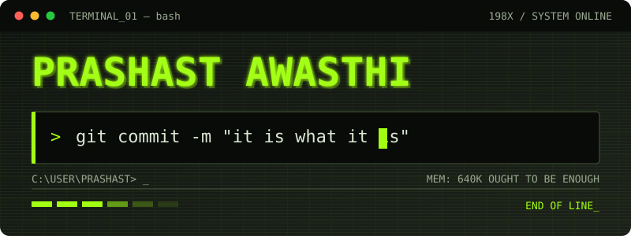

<div align="center">

<!-- Typing animation -->
<a href="https://github.com/awasthiprashast">
  
</a>

<br/>

[](mailto:prashast.awasthi2212@gmail.com)

</div>

---

## 👨‍💻 About Me

```python
class Prashast:
    def __init__(self):
        self.role      = "Developer & Builder"
        self.focus     = ["AI/ML", "Computer Vision", "Cloud (AWS)", "IoT"]
        self.currently = "Building privacy-preserving, real-time systems"
        self.fun_fact  = "My profile picture is a thinking monkey. Deep thoughts only. 🐒"

    def say_hi(self):
        return "Let's build something cool together!"
```

- 🔭 Working on **privacy-first computer vision** and **serverless cloud apps**
- 🌱 Exploring **Terraform, MLOps and event-driven architectures**
- 💬 Ask me about **FastAPI, Streamlit, MediaPipe, ESP32, AWS**
- ⚡ Time zone: IST (UTC +05:30)

---

## 🛠️ Tech Arsenal

<div align="center">

**Languages**<br/>


**Backend & Cloud**<br/>


**CV, IoT & Tools**<br/>


</div>

---

## 🚀 Featured Projects

<div align="center">

| Project | What it does | Stack |
|---|---|---|
| 👁️ [**computer-vision-attention-monitoring**](https://github.com/awasthiprashast/computer-vision-attention-monitoring) | Privacy-preserving, real-time attention monitoring for online learning. On-device MediaPipe scoring | `Python` `FastAPI` `PostgreSQL` `Streamlit` `Terraform` |
| 🚨 [**Adaptive-Risk-Detection-System**](https://github.com/awasthiprashast/Adaptive-Risk-Detection-System) | ESP32 multi-sensor risk detection with a live web dashboard | `ESP32` `HTML` |
| 📦 [**Order-tracking-system**](https://github.com/awasthiprashast/Order-tracking-system) | Full-stack order & delivery tracking with role-based access and real-time status | `FastAPI` `HTML` |
| 📱 [**social-media-content-analyzer**](https://github.com/awasthiprashast/social-media-content-analyzer) | Scores post engagement potential and suggests improvements for LinkedIn, Instagram, Facebook & X | `TypeScript` |
| 📈 [**stock-sentiment-analyzer**](https://github.com/awasthiprashast/stock-sentiment-analyzer) | Sentiment analysis on stock-related news | `Python` |
| ☁️ [**aws-serverless-to-do-application**](https://github.com/awasthiprashast/aws-serverless-to-do-application) | Serverless to-do app on AWS | `JavaScript` `AWS` |

</div>

---

## 🤝 Let's Connect

<div align="center">

I'm always up for collaborating on **AI, cloud, or IoT** projects. Open an issue, drop a star ⭐, or send me an email!

[](mailto:prashast.awasthi2212@gmail.com)
[](https://linkedin.com/in/prashast-awasthi)

</div>

